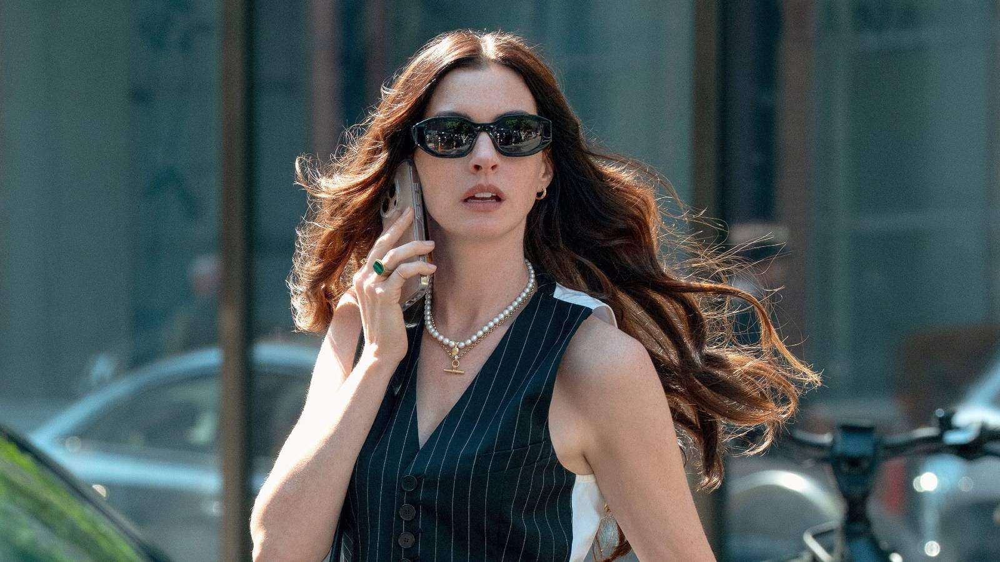
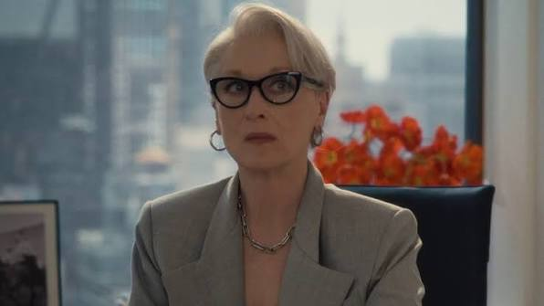
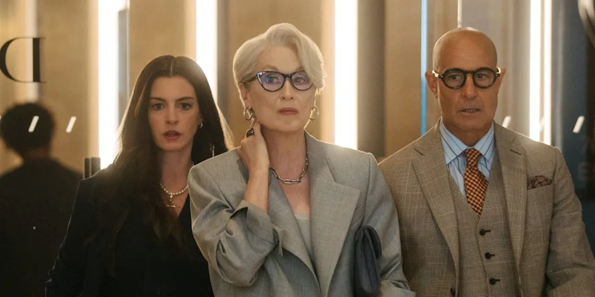
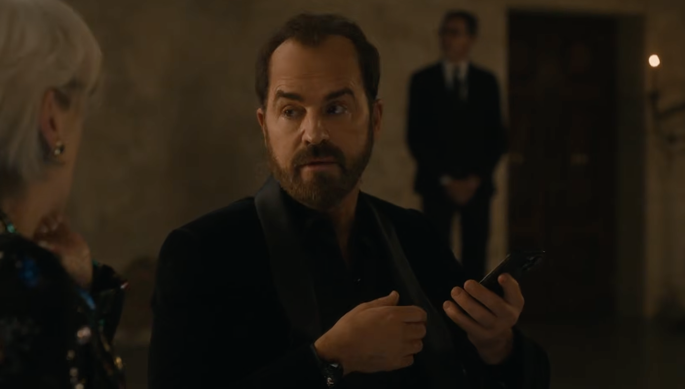
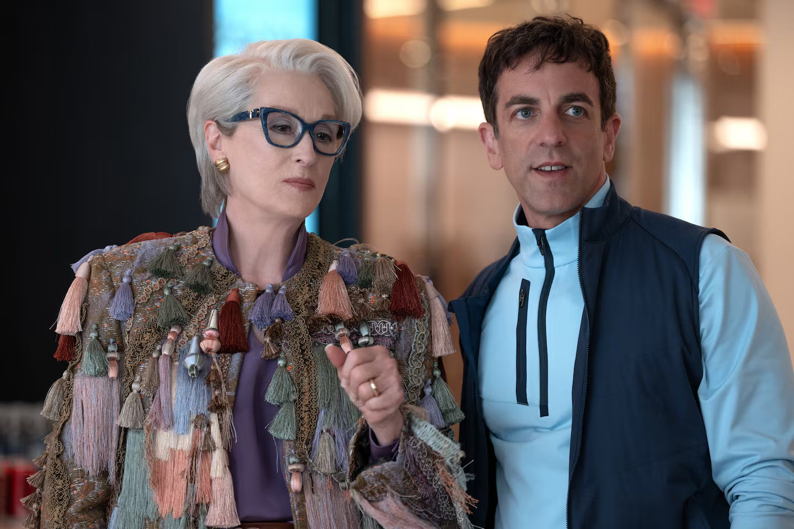
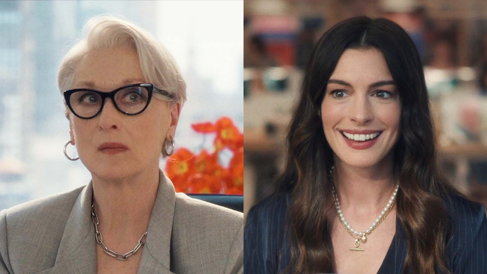
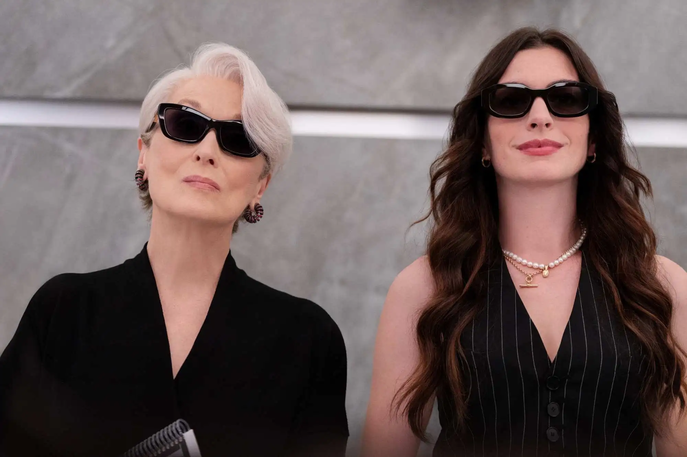
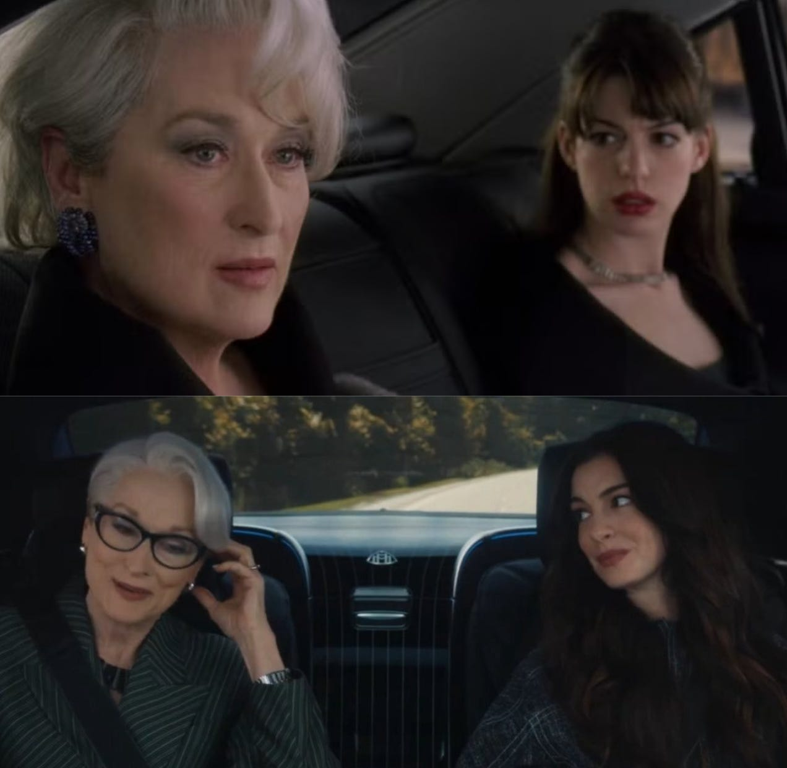
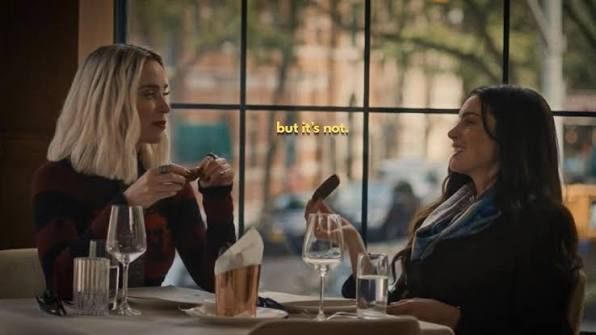
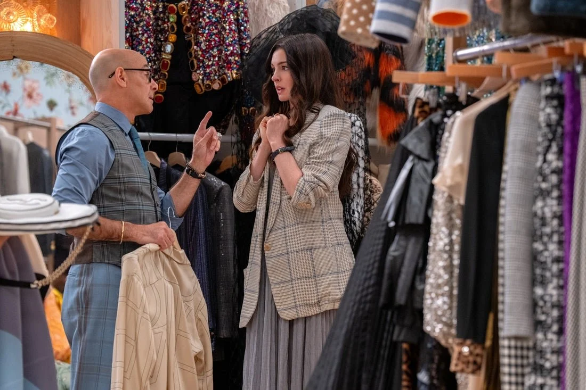

AI 광풍이 부는 지금, 요새 가장 많이 생각하는 것은 '어떻게 살 것인가? 어떤 가치를 추구할 것인가?'다. 시간이 없어서, 능력이 없어서 하기 어렵던 일들이 이제는 정말 쉬워지고 나니, '하면 할 수는 있으니 무엇을 할 것인가'가 문제가 되었기 때문이다.

다음으로 많이 생각하는 것은 '누구와 같이 할 것인가?'다. 능력의 증강으로 협업은 선택지가 되었다. 그래서 이 시대에 내가 누구와 같이 일해야 한다면 어떤 사람이어야 할까? 나는 내가 아는 것을 누구와 나누고 싶은가를 자주 생각한다. 

이렇듯 나처럼 이 문제에 천착하고 있다면  &lt;악마는 프라다를 입는다 2&gt;에서 힌트를 얻을 수 있을 것 같다. 나는 이 영화를 하루가 고달픈 직장 월드에서 (여러 싫음에도 불구하고) 친구가 될 수 있는 조건에 대한 이야기로 받아들였다.

<!--more-->

## 20년 후, 톡쏘는 맛은 사라지고 슴슴하고 쿰쿰해진 직장 라이프
{: #twenty-years-later data-toc="한 시대의 끝, 직장인의 모습"}

영화 오프닝송이 두아 리파의 End of an Era더라니. 그럴 줄 알았다. 1편 이후 20년이 지났고 정말 많은 것이 변했다.

- **20년차가 된 앤디**는 탐사보도로 상을 받는 유능한 기자가 되었다. 그러나 신문사 수익 악화로 인한 폐업으로 해고되었다. 20년 전 패션보다 더 큰 이상과 비전이 있다며 자신만만해하던 신입은 저널리즘의 가치가 떨어졌다며 울분을 토하고 벌이의 스트레스에 몸부림치는 생활인이 됐다.
- **최소 40년차가 된 미란다**는 그때도 지금도 패션의 정점에 있다. 미란다의 안목과 영향력은 여전하지만  치실로 쓸 수 있을만큼 얇아진 패션 잡지처럼 그녀의 세상 자체가 쪼그라들었다. 그래서 광고주를 선택하는 입장에서  광고주를 만나고 설득해야하는 입장이 되었다. 초연함을 유지하기 위해 애써야 하는 시기다.

정리하면 두 사람이 하는 일은 여전하지만 그 일을 떠받치는 회사의 권력, 돈, 질서가 달라졌다.  잘하는 것만으로 자리를 지킬 수 있는 시대가 끝난 것이다. 상을 받아도 해고되고, 오랫동안 업계의 기준을 만들어온 사람도 광고 영업을 해야한다. 이렇듯 대부분이 믿어왔던 것이 뒤집히고 있는 시대의 끝이 영화의 배경이다.

그래서 2편은 1편만큼 사이다맛은 없다. 성공을 향해 진격하는 커리어우먼의 이야기가 아니라, 이미 정점에 오른 사람들이 그 일을 계속하기 위한 버티기와 몸부림이라 슴슴하다 못해 쿰쿰하다. 

  

  

## 한 시대가 끝날 때 직장인으로서 대처하는 자세는?
{: #surviving-change data-toc="변화에 대처하는 두 모습"}

이런 시대에 직장인은 어떤 자세를 취해야 할까? 역시나 직장인의 지상과업은 살아남는 것이니, 역시나 빠른 태세 전환? 

### 변화 속에서도 하려는 일을 계속 하는 자
{: #preserving-the-present data-toc="현재를 지키는 사람들"}

앤디와 미란다는 현재의 변화를 온몸으로 맞으면서도 자기가 추구하던 일을 계속하려 애쓴다. 앤디는 계속 좋은 글을 쓰고 싶어 하고, 미란다는 아름다움의 기준을 제시하고 싶어 한다. 나이젤은 조용히 자신이 해야 할 일에 집중한다. 이들이 자리를 지키려는 것은 가치를 지키려는 것일까?  본인들의 입지를 지키기 위한 시대착오적 버티기는 아닐까?

### 변화를 받아들이고 가속해야 한다는 자
{: #pushing-change data-toc="변화를 온몸으로 끌어내는 사람들"}

사업가 제이와 벤지는 숫자와 효율에 민감하고 변화를 밀어붙이는 최전선에 있다. 구조 조정, 데이터, 조회수, 광고, 운영 효율, 수익성을 무기로 사용하면서. 변화를 폼페이의 용암에 빗대며 용암에 쓸려나가지 않으려면 이 흐름을 받아들여야 한다고 말한다.

> 벤지: 미래가 우리를 향해 돌진하고 있어요, 폼페이의 용암처럼.  
> 그 흐름을 받아들이는 게 우리가 할 일이죠. 설령 인류가 그 용암에 집어삼켜지더라도요.

내가 하는 일은 사실 벤지와 제이가 하는 일에 가깝다. 그런데 벤지가 변화가 폼페이의 용암이라 하니 듣는 순간 거부감이 들었다. 잡아먹히지 않으려면 변화에 맞추는 것만이 멸망을 피할 유일한 선택지인 것처럼 들렸기 때문이다.

  

  

이런 기시감을 예전에도 느낀 적이 있다. 대학생때 대기업 채용 서류 정리 알바를 했었는데, 서류에 평가 기준이 가혹하고 점수가 많고 세세해서 압도되었었다. 그래서 '이 기준에 맞추는게 가능하긴 할까요?' 라고 하니 옆에 있던 오빠가 '그런 사람이 되게 맞춰야지. 되게 해야지' 라는 말을 들었을 때 딱 그랬다. 

나는 일을 하기 위해 존재하는 사람이 아니고, 일을 통해 내가 중요하다고 생각하는 것을 하고 나로서 존재하기 위해 일을 하려는 것인데, 남이 원하는대로 다 바꾸라고? 라는데서 오는 반발심이었다. 그 오빠의 말은 현실적인 말이지만 나라는 사람이 원하는 건 하나도 중요하지 않다는 것처럼 들렸기 때문에 불편했다.

## 20년이 지나도, 미란다와 앤디, 역시나 우리는 안 맞아
{: #miranda-and-andy data-toc="일하는 스타일이 다른 사람"}

1편에서 미란다와 앤디는 서로를 인정하고 나름 애틋하게 헤어졌던 것 같다. 하지만 다시 만나보니 역시나 둘은 안 맞는다. 연차도, 경력도 다르고 일하는 방식도, 사람을 대하는 태도도 다른, 정말 다른 사람이다.

미란다는 결과와 자신이 세운 기준이 중요하고, 그 기준을 위해서라면 사람을 시험하고, 누군가를 밀어내고, 희생시키는 것도 주저하지 않는다. 30여년간 묵묵히 곁을 지켜온 나이젤 또한 예외는 아니다. 앤디도 일을 잘하고 성공하고 싶어하지만 미란다의 방식에 거부감이 있다.

**그런데 벤지와 제이라는 숫자쟁이 사업가들이 등장하자 미란다와 앤디는 이상할 만큼 비슷한 사람처럼 보인다**. 벤지와 제이가 숫자와 효율과 같은 정량 성과로 모든 것을 치환한다면, 미란다와 앤디는 영역은 달라도 궁극적으로는'현/미래 세대에 무엇이 가치 있는지를 발굴하고 전달하고 싶어하는 사람'들이기 때문이다.

## 그래서 그럼에도 불구하고 동료가/친구가 될 수 있는 사람
{: #becoming-allies data-toc="동료가 될 수 있는 사람"}

1편에서 부각된 것은 미란다와 앤디, 에밀리와 같은 사람간 차이였다. 일하는 스타일, 마인드, 싸가지와 같이 '스타일의 차이'에 대한 것이 주된 내용이었다. 한 업계에서 벌어지는 일을 그렸으니까.

그런데 2편에서 일에서 추구하려는 방향의 대립에 대한 이야기로 바뀌자, 미란다와 앤디는 같은 편이 된다. 영화에서 등장인물은 형이상학적 가치를 추구하는 사람, 형이하학적 가치를 추구하는 사람으로 나뉘는데 누가봐도 미란다와 앤디는 형이상학적 가치를 추구하는 사람들이니까.

- 미란다와 앤디는 지키고 싶은 가치와 세상에 전달하고 싶은 선명한 메시지가 있는 사람들이다. 그들의 일은 추구하는 가치를 구현하는 수단이며, 내 시선에 사람들을 환기하고 주목하게 하는데 목적이 있다.
- 반면 사업가 벤지와 제이는 형태가 있고 측정할 수 있는 가치를 추구하는 사람들이다. 데이터, 조회수, 광고, 운영 효율, 수익, 효율성, AI 알고리즘.... 측정하고 관리할 수 있어야 한다고 생각한다.

그럼에도 친구가/동료가 되는 조건이 이것인 것 같다. **잘 맞는 사람이 아니라, 그 사람이 무엇을 지키고 싶은지, 무엇을 지향하는지 이해하는 것.** 앤디는 미란다의 방식에는 동의할 수 없지만, 그 사람이 무엇을 하고자 하고 그 일을 왜 잡고 있는지는 이해하기 때문에 같은 편에 서는 것이다. 정치적 단합과는 또 다른 영역에서...

## 우리는 다르지만 같이 재미있는 일을 해볼 수 있겠다
{: #working-together data-toc="동료가 되는 사람들"}

1편과 2편 모두 마지막에 미란다와 앤디가 차를 타고 대화하는 장면이 나온다. 두씬 모두에서 앤디는 미란다의 말에 뼈를 맞지만 반응은 예전과는 다르다.

- 1편에서 미란다는 앤디도 너의 '스타일'도 자신과 다르지 않다고 말한다. 미란다가 본인을 위해 나이젤을 밀어낸 것처럼, 너도 에밀리를 밀어낸 사람이라고. 그래서 앤디는 충격을 받고 떠났다.  미란다와 같은 부류라는 말은 받아들이기 어려운 것이었으니까.
- 2편에서 미란다는 저널리즘과 동료애를 이야기하는 앤디에게 '너는 스스로를 구하기 위해, 런웨이에 합류하고, 잡지 인수전에 뛰어든 것 뿐이야'라고 말한다. 이번에도 앤디는 당황하지만 전과 반응은 다르다. 그럴지도 모르지만 우리는 여전히 좋은 일을 함께할 수 있을 것 같지 않냐고.

     앤디의 답변이 더 돋보이는 이유는 이 앞부분에 가장 멋진 씬이 나오기 때문이다.

> 미란다: 사람들도 알아야 해. 대가가 따른다는 걸. 하지만 난 일하는 게 정말 좋아. 정말로. 너도 그렇지?  
> 앤디: 네 저도 그래요.

너와 나의 방식은 다르지만 우리 모두 일을 하는 걸 정말 좋아하는 사람이잖아. 라는 공감대가 만들어진 것이 좋았다. 그래서 앤디가 동기는 어떨지 모르지만 어쨌든 우리 재미있는 일을 해볼 수 있을 것 같지 않냐 답변할 수 있지 않았을까?

결국에는 상대가 지향하는 세계를 이해한다면 너의 방식과 나의 방식이 다르더라도 친구가 될 수 있다. 아닐까?

## 우리는 동료를 넘어서 약간은 친구가 될 수도 있을 지도 
{: #emily-and-nigel data-toc="친구가 되는 동료들"}

영화는 벤지와 미란다, 벤지와 샤샤 처럼 극적으로 다른 인물들을 대조한다. 그런데 어느 한 쪽이라고 구분하기 어려운 사람들도 있다. 바로 에밀리와 나이젤이다. 슴슴한 영화에서 슴슴한 캐릭터, 슴슴한 악인이랄까?

앤디는 나이젤과도 친구였고 배신을 도모한 에밀리와도 친구가 된다. 나는 이들이 앤디와 친구가 될 수 있었던 것 또한, 비슷한 지향에 대한 이해라고 생각한다. 상대가 무엇을 원하는지, 무엇을 포기할 수 없는지 이해하기 때문에.

  

  

- **에밀리**는 일도 잘하고 아름답고 커머셜 감각이 있는 사람이다. 하지만 에밀리는 커머셜에서 능력을 인정받으면서도 미란다처럼 '패션 업계에 지향점을 제시하는 사람'이 되는 것을 갈망한다. 그래서 좌절했고 인수 모략을 꾸민다. 앤디는 에밀리의 좌절을 이해했기 때문에 에밀리와 기꺼이 친구가 되었다.
- **나이젤**은 추구하는 세계를 위해 인내하는 사람이다. 그는 미란다의 방식 때문에 상처받고 매번 손해를 보면서도 그 세계를 떠나지 않는다. 미란다에게 충성한다기보다 자신이 오랫동안 만들어온 일과 일의 퀄리티를 지키는게 더 중요하니까. 뭐라 하건 나는 이 일이 좋아-의 다른 표현이라 생각한다. 나이젤이 앤디에게 하는 조언에서 그의 마인드를 가늠할 수 있다.

> 앤디: 내가 위기를 수습했잖아요. 미란다는 그거 인정해주는게 그렇게 어려운건가요?  
> 나이젤: 인정받고 싶어하시는구만~ 칭찬이라고 해줘야 하나? 
>
> 앤디: 아니오. 저는 건설적인 피드백을 바라는 거라구요.   
> 나이젤: 사탕을 원하는거야? 피드백을 원하는거야?  
> 이 일이 필요하지? 이 일을 하기로 했지? 그럼 어린애처럼 굴지말고 스스로 이 일을 해낼 방법을 찾아봐.

이렇게 보면 나와 내 동료가 어떤 사람인지는, 무엇을 포기하지 못하는지로도 알 수 있는 것 같다.

개인적으로는 에밀리가 정말 현실적인 캐릭터라 공감이 되었다. 가진 것과 원하고 지향하는 것은 다를 수 있는 것이니까...

## 나는 누구와 동료/친구가 되어 함께 일하고 정보를 나눌 것인가?
{: #who-to-work-with data-toc="누구와 일할 수 있을 것인가?"}

영화는 기대만큼 매콤하지 않았지만, 몇 가지 질문을 남겼다.

- 변화에 맞추고 살아남으려는 와중이지만, 나는 내 일을 통해 무엇을 만들고 싶은가.
- 나는 무엇을 좋아하고 무엇을 추구하는가? 
- 마음을 알아보고 함께 일하며, 내가 아는 것을 나누고 싶은 사람은 누구인가.

사실 요즘 잘 맞지 않는 사람 때문에 조금 날이 서 있었다. 그런데 이 글을 쓰다 보니 우리가 부딪힌 것은 일하는 스타일이었고, 더 크게 보면 같은 지향을 가진 사람들이라는 걸 잊고 있었다. 

실제 영화를 보고 직장에서 만난 동료이자 친구들이 떠올랐는데, 처음에 나와 안 맞는다고 느낀 사람들이 절반은 되는 것 같다.

- 내게 회사를 소개해 준 친구는 매번, 끝까지 새로운 방법론을 제시하는 발산왕이었다. 그만... 이라는 말을 정말 하고 싶게 했는데, 그는 늘 해외의 그로스 방법론을 공부하고 매번 바로 적용하려고 시도해보는 중이었고, 그걸 사람들에게 알려주고 같이 하고 싶어하는거였다.
- 내가 회사에 소개한 친구는 논리왕 파이터라 피곤했다. 그런데 이 친구를 나중에 보니  미팅에서 상대를 설득하기 위해 정말 열심히 준비했고 그런만큼 결정에는 깨끗이 승복했다. 
- 전 회사 상사는 피드백이 빡빡해 힘들었지만 본인이 바쁘고 힘들어도 항상 최선을 다해 이 사람이 발전하기 위한 구체적인 피드백을 주던 사람이었다.

우리 모두 내가 하는 일을 이해하고 잘 해내고 싶은 것들이 있었고 최선을 다해오고 있었다. 그 사람이 무엇을 추구하는지, 공부한 것을 나누는 이유, 원리를 끝까지 파고드는 이유, 리뷰 하나에도 시간을 쓰는 이유와 같은 이 사람의 세계를 들여다보면서 나와 달라도 좋아할 수 있었고 배웠고 친구가 될 수 있었다. 

벤지를 보면서 내가 옳다고 생각하는 변화를 모두가 당연히 따라야 하는 것처럼 강요하지 말아야지 다짐했다. *나와 부딪히는 누군가의 방식이 아니라 그 사람이 궁극적으로 만들고 싶은 것이 무엇인지, 무엇을 중요하게 여기고 어떻게 시간을 쓰는지 순수하게 궁금해하고 싶다*. 

당장은 아주 달라 보여도 더 큰 방향에서 같은 것을 추구한다면, 언젠가는 같은 편에 서서 재미있는 것들을 해볼 수도 있을 테니까.

