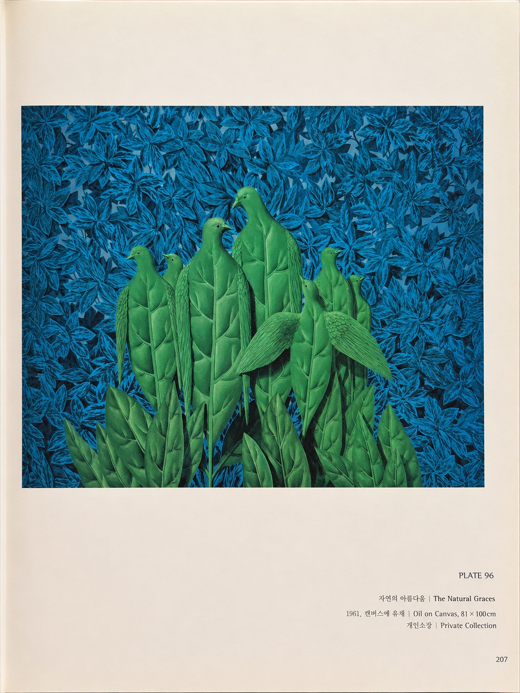

**요새 들어 미술 도록을 보는 일이 재밌어졌다.** 예전에는 도록을 소중하지만 비싸고 귀한 책(어쩌면 비싸서 귀하고 소중한 책) 정도로만 생각하고 모셔두고 살았다. 그런데 요즘에는 그림을 보고 나름대로 해석하다 보면 뇌가 따뜻해지면서 뇌 사이에 낀 굳은 기름이 떨어져 나가는 느낌이 든다.

평소 당면한 걱정과 할 일에 매몰되다 보니 늘 비슷한 방식의 사고를 반복하는 것 같은데, 그림을 들여다보고 있으면 뇌가 스트레칭을 하는 것 같다. 여유도 생기고…

<!--more-->

오늘은 좋아하는 카페에서 르네 마그리트(René Magritte)의 도록을 봤다.

## 눈물의 맛(The Flavour of Tears)
{: data-toc="눈물의 맛"}

오늘 마음에 들었던 그림이다.

{: .yb-artwork-image }

  
<strong>눈물의 맛</strong> · <em>The Flavour of Tears</em>

  
1948 · 캔버스에 유채 · 60 × 50 cm

  
벨기에 왕립미술관 · Royal Museums of Fine Arts of Belgium

처음에는 새 가슴 때문에 눈에 들어왔다. 새가 사람처럼 갑바가 뽝! 있어서 웃겼는데, 자세히 보니 더 재미있다.

그 단단한 사슴 근육이 나뭇잎으로 만들어져 있다. 굉장히 튼튼해 보이지만 실체는 연약한 나뭇잎인 것. 게다가 가슴 한가운데에는 애벌레가 갉아먹은 흔적까지 남아 있다. 왕벌레도 아니고 고작 애벌레에게 당함 ㅎㅎ

〈눈물의 맛〉이라는 제목도 여러 생각을 하게 한다.

새는 아래를 내려다보고 있다. 울고 있는건가? 그렇다면 저 새의 눈물의 맛은 어떤 맛일까? 스리슬슬 좀이 슬고 삭는, 느린 고통의 맛일까? 단련에 단련을 했지만, 그럼에도 나뭇잎이라는 나의 본질은 작은 고통에도 생채기가 난다는 자각과 슬픔이 그 눈물의 이유일까?

## 자연의 아름다움(The Natural Graces)
{: data-toc="자연의 아름다움"}

도록에 비슷한 잎과 새의 병합 모티브가 등장하는 그림이 있어 남겨둔다. 제목은 자연의 아름다움. 유익하나 단련한 자들, 그래서 강건한 자들의 자신감과 아름다움이려나 ?

{: .yb-artwork-image }

  
<strong>자연의 아름다움</strong> · <em>The Natural Graces</em>

  
1961 · 캔버스에 유채 · 81 × 100 cm

  
개인 소장 · Private Collection

🎁 르네 마그리트의 그림을 더 보고 싶다면 
[https://fine-arts-museum.be/fr/la-collection/rene-magritte-la-saveur-des-larmes](https://fine-arts-museum.be/fr/la-collection/rene-magritte-la-saveur-des-larmes){:target="_blank" rel="noopener"}

  
